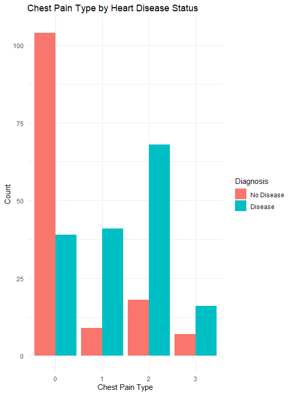

# Heart Disease Risk Prediction & Patient Clustering (R)

## Business Problem
Cardiovascular disease is a leading cause of mortality, making early risk identification critical for healthcare providers and insurers to prioritize screenings and allocate clinical resources effectively. 

Using clinical and demographic records from **1,025 patients** (deduplicated to **302 unique patient profiles** across four clinical sites), this project evaluates supervised classification models and unsupervised clustering in **R** to identify key physiological predictors of heart disease.

## Methodology & Key Findings
* **Data Cleaning & Deduplication:** Identified and removed 723 exact duplicate records (70.5% of the raw file) to prevent data leakage between training and test splits, and properly factored 8 categorical clinical indicators (`cp`, `thal`, `ca`, `slope`, etc.).
* **Exploratory Data Analysis (`ggplot2` / `corrplot`):** Discovered that **maximum heart rate achieved (`thalach`)** and **chest pain type (`cp`)** provided far stronger separation between diagnosed and healthy patients than traditional standalone indicators like age or cholesterol.
* **Supervised Classification (75/25 Train-Test Split):** Benchmarked a C5.0 Decision Tree against a Naive Bayes classifier across all 13 clinical predictors:

| Evaluation Metric | Decision Tree (C5.0) | Naive Bayes |
| :--- | :---: | :---: |
| **Accuracy** | 76.3% | **85.5%** |
| **Sensitivity (Recall / TPR)** | 86.8% | **97.4%** |
| **Specificity (TNR)** | 65.8% | **73.7%** |
| **Precision** | 71.7% | **78.7%** |
| **F1 Score** | 78.6% | **87.1%** |

* **Unsupervised Segmentation (K-Means Clustering):** Standardized continuous clinical variables and applied the elbow method ($k = 3$). Cluster 3 (younger patients with the highest maximum heart rates) exhibited a **76% heart disease prevalence**, independently confirming the predictive findings.

## Visual Highlights

## Repository Contents
* `heart_disease_classification.R` — Complete R script for preprocessing, deduplication, `ggplot2` visualizations, C5.0 Decision Tree, Naive Bayes, and K-Means clustering.
* `Heart_Disease_Data_Mining_Report.pdf` — Full technical report with statistical summaries, clinical interpretations, and limitations.
* `data/heart.csv` — Source clinical dataset.
